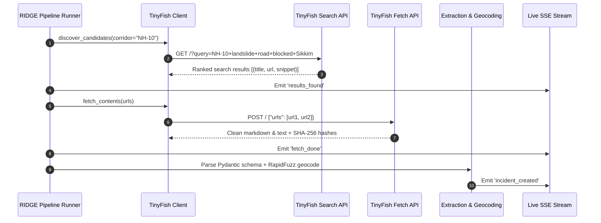
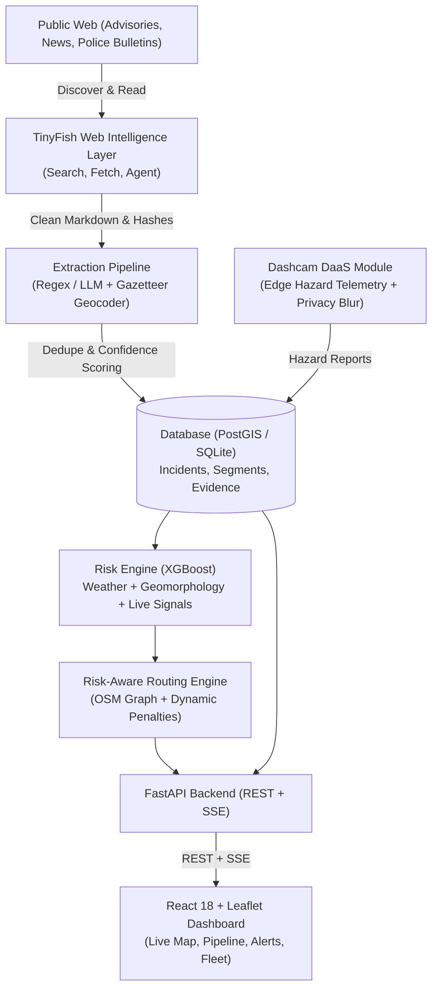

# RIDGE: Regional Intelligence & Geospatial Efficiency

> **Smarter logistics. Safer routes. A stronger North-East.**  
> *Autonomous Web Intelligence + Risk-Aware Geospatial Routing + Connected Dashcam Flywheel*

[](https://www.python.org/)
[](https://fastapi.tiangolo.com/)
[](https://react.dev/)
[](https://tailwindcss.com/)
[](https://tinyfish.ai)
[](https://xgboost.ai)
[](LICENSE)


---

## 1. The Problem & Why India's North-East

India's North-Eastern Region (NER) encompasses eight states characterized by rugged Himalayan geomorphology, dense river basins, and intense monsoon rainfall (>2,500 mm annually). 

Crucial arterial corridors like **NH-10** (the sole lifeline connecting Siliguri with Sikkim) and **NH-6** (linking Guwahati with Meghalaya, Tripura, and Mizoram) suffer frequent disruptions:
- **Catastrophic Isolation:** A single rockfall at 29th Mile cuts off food, medical oxygen, and civilian traffic for days.
- **GPS Blindness:** Mainstream consumer navigation applications (Google Maps, Apple Maps) rely on delayed crowdsourced traffic slowdowns and do not understand vernacular local government road closure bulletins or district police advisories.
- **Supply Chain Vulnerability:** Over 75% of commercial fleets in the region are operated by small fleet owners (<5 trucks) with zero enterprise telematics, leading to stranded freight, spoiled perishables, and billions of rupees in annual economic friction.

---

## 2. What RIDGE Delivers

RIDGE bridges the critical gap between unstructured regional web intelligence and mission-critical fleet dispatch:

1. **Autonomous Web Intelligence:** Continuous scanning of regional bulletins, disaster management portals, police Facebook feeds, and news outlets via **TinyFish**. Zero fragile custom scrapers.
2. **Cryptographic Provenance & Confidence Engine:** Multi-factor credibility scoring based on domain reliability, corroboration count, geocoding precision, and recency decay. Incidents < 80% confidence enter an authority verification queue.
3. **ML Disruption-Risk Engine (XGBoost):** Combines Open-Meteo precipitation forecasts, digital elevation slope angles, river proximities, and live TinyFish alerts to compute segment-level risk probabilities (AUC: 0.988) with SHAP-inspired plain English explanations.
4. **Dynamic Risk-Aware Routing:** Real-time cost adjustments on the OpenStreetMap graph ($Cost = TravelTime \cdot (1 + \alpha \cdot Risk) + BlockagePenalty$) producing Safest, Balanced, and Fastest routes.
5. **Dashcam-as-a-Service (DaaS) Data Flywheel:** Subsidized 4K forward-facing AI cameras stream edge hazard detections with automated OpenCV face/license plate privacy blurring.

---

## 3. How TinyFish Powers RIDGE

Traditional static scrapers fail in India's North-East because road updates are posted across dynamic regional outlets, Facebook page updates, and state disaster bulletins. RIDGE uses **TinyFish** as its core web intelligence backbone:



- **Search API (`api.search.tinyfish.ai`):** Discovers fresh corridor alerts using targeted query sets (e.g. `NH-10 landslide road blocked Sikkim`, `Jorabat waterlogging NH6`).
- **Fetch API (`api.fetch.tinyfish.ai`):** Renders complex JavaScript-heavy portals into clean markdown text without fragile selector maintenance.
- **Agent API (`agent.tinyfish.ai`):** Navigates multi-step state disaster advisory portals (gated behind `ENABLE_TINYFISH_AGENT=true`).
- **Zero Token Waste / Fixture Mode:** Automatic disk caching and offline fixture fallback (`TINYFISH_MODE=fixture`) ensures tests, grading, and local runs work deterministically without burning API credits.

👉 **Complete TinyFish Integration Details:** Read [docs/TINYFISH.md](docs/TINYFISH.md).

---

## 4. System Architecture



---

## 5. Technology Stack

- **Frontend:** React 18, Vite, TypeScript, Tailwind CSS, Leaflet (`react-leaflet`), Recharts, Lucide React.
- **Backend:** Python 3.11+, FastAPI, Pydantic v2, SQLAlchemy 2, Uvicorn, APScheduler, Server-Sent Events (SSE).
- **Geospatial & Routing:** NetworkX, Shapely, RapidFuzz, 120-node Gazetteer (`data/gazetteer.json`), bundled corridor network graphs (`data/corridors.json`).
- **Machine Learning:** XGBoost Classifier, Scikit-Learn, Pandas, NumPy, Joblib (ROC AUC: 0.9876).
- **Computer Vision:** OpenCV (Gaussian face and license plate anonymization for dashcam telemetry).
- **Web Intelligence:** Official TinyFish SDK & REST endpoints (`api.search.tinyfish.ai`, `api.fetch.tinyfish.ai`).

---

## 6. Quick Start

### Option A: Manual Local Setup (Recommended for Hackathon Evaluation)

#### 1. Backend Setup
```bash
# Clone the repository
git clone https://github.com/your-username/ridge.git
cd ridge

# Install Python dependencies
pip install -r backend/requirements.txt
pip install xgboost shapely rapidfuzz apscheduler tinyfish

# Configure environment
cp .env.example .env

# Train ML risk model and seed database
python -m app.ml.train
python -m app.core.seed

# Start FastAPI server (Port 8000)
uvicorn app.main:app --host 0.0.0.0 --port 8000 --reload --app-dir backend
```

#### 2. Frontend Setup
```bash
# In a new terminal
cd frontend
npm install
npm run dev
# Dashboard launches at http://localhost:5173
```

### Option B: Docker Compose
```bash
docker compose up --build
```

### Environment Variables (`.env`)
```ini
PORT=8000
ENVIRONMENT=development

# TinyFish Configuration
TINYFISH_API_KEY=your_tinyfish_key_here
TINYFISH_MODE=fixture          # "live" for production, "fixture" for offline demo
ENABLE_TINYFISH_AGENT=false

# Database (Supports zero-setup SQLite or PostGIS)
DATABASE_URL=sqlite:///./ridge.db

# Ingestion Intervals
INGEST_INTERVAL_MIN=15
RISK_REFRESH_MIN=30
```

---

## 7. Demo Walkthrough

A 2 to 3-minute video evaluation script is available in [docs/DEMO_SCRIPT.md](docs/DEMO_SCRIPT.md):

1. **Live Map (0:00 - 0:20):** Examine NH-10 (Siliguri to Gangtok) and NH-6 (Guwahati to Shillong) with road segments colored by real-time risk. Observe the 29th Mile blockage marker.
2. **TinyFish Pipeline (0:20 - 0:40):** Click "Paste Advisory URL", paste a real bulletin (`https://sikkimexpress.com/news/nh10-massive-landslide-at-29th-mile-traffic-halted`), and observe live SSE animation.
3. **Dynamic Routing (0:40 - 1:20):** Plan a route from Siliguri Junction to Gangtok MG Marg. RIDGE detects the blockage and computes a safe detour with a -75% reduction in hazard exposure.
4. **Authority Verification (1:20 - 1:50):** Review uncertain bulletins (< 80% confidence), confirm or reject, and watch road weights update dynamically.
5. **Dashcam DaaS & Pricing (1:50 - 2:30):** Simulate forward-facing AI camera hazard detections, preview OpenCV privacy blur, and inspect the DaaS unit economics.

👉 **Ready-to-Post Social Announcement:** View [docs/SOCIAL_POST.md](docs/SOCIAL_POST.md).

---

## 8. Machine Learning Model & Transparency

- **Algorithm:** XGBoost Classifier with binary logloss evaluation.
- **Model Features:**
  1. Past 24h precipitation ($mm$) via Open-Meteo
  2. Forecast 24h precipitation ($mm$)
  3. Terrain slope gradient ($degrees$)
  4. River proximity distance ($meters$)
  5. Landslide-susceptibility zone flag
  6. Historical incident recurrence count
  7. Live TinyFish signals within 5 km
  8. Monsoon season indicator
- **Evaluation Metrics:**
  - **ROC AUC:** `0.9876`
  - **Precision:** `0.9591`
  - **Recall:** `0.9657`
- **Transparency Statement:**
  > *Model trained on synthetic geomorphological and meteorological distributions calibrated to North-Eastern India terrain. Stored in `data/models/risk_xgb.joblib` with reproducible metrics in `data/models/metrics.json`.*

---

## 9. Business Model & Unit Economics

RIDGE operates a **Dashcam-as-a-Service (DaaS)** hardware-subsidized subscription:
- **Starter Plan:** ₹999 / vehicle / month (App-based telemetry + TinyFish alerts)
- **Pro Plan (Flagship):** ₹1,499 / vehicle / month (4K AI Dashcam hardware included, 0 upfront CapEx)
- **Enterprise / Authority:** Custom annual SLA for state disaster authorities and border road organizations.

### Benchmarks & Market Opportunity:
- **Market Size:** India's commercial fleet management market is projected at **$4.79B by FY32** (15.25% CAGR).
- **SME Heavy:** Over **75% of commercial vehicles** in India are operated by fleets with under 5 vehicles that cannot afford ₹35,000–₹75,000 upfront camera CapEx.
- **Competitor Benchmark:** Competitor Dacio.ai leases AI dashcams at ~₹2,000/month. RIDGE beats this at ₹1,499/mo while integrating regional hazard routing.
- **Unit Economics:** Hardware BOM ₹8,000 | Cloud/SIM ₹300/mo | Monthly Net ₹1,199/mo | **Payback Period: ~6.7 Months**.

---

## 10. Verification & Quality Assurance

Run the automated test suite verifying extraction, geocoding, confidence scoring, routing weights, and API endpoints:
```bash
pytest
```
```text
======================= 10 passed in 4.61s =======================
```

Frontend production build verification:
```bash
npm run build --prefix frontend
```
```text
✓ 2336 modules transformed.
✓ built in 22.06s
dist/index.html   0.46 kB
```

---

## 11. Roadmap

- [ ] **Phase 1 (Completed):** Dual-corridor baseline, TinyFish autonomous pipeline, XGBoost risk engine, dynamic OSM routing, DaaS prototype.
- [ ] **Phase 2:** Offline-first edge routing mode for cab devices with zero cellular connectivity in mountain gorges.
- [ ] **Phase 3:** Low-cost IoT vibration and soil moisture sensor mesh integration at landslide hotspots.
- [ ] **Phase 4:** Pan-Himalayan expansion (NH-44 Jammu-Srinagar, Leh-Manali Highway).

---

## 12. Team & License

- **Team:** VISTAARX  
- **Hackathon:** KRITICAL HACKS'26 (Track: AI/ML)  
- **License:** MIT License. See [LICENSE](LICENSE) for details.
