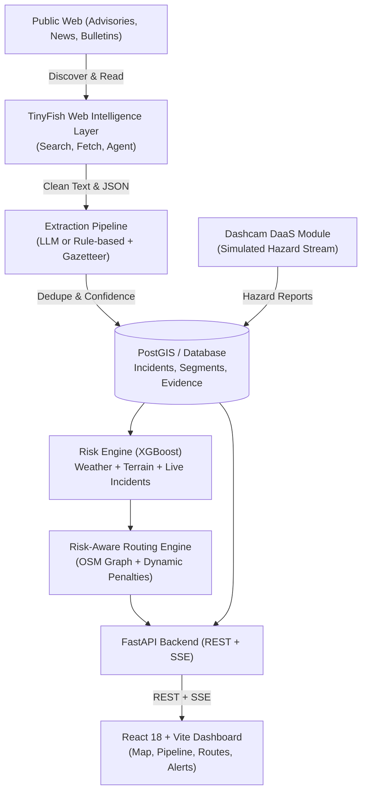

# RIDGE System Architecture

## Architectural Highlights
1. **TinyFish Layer**: Zero manual scrapers. TinyFish Search discovers live corridor bulletins, Fetch renders full text, and Agent navigates complex advisory portals.
2. **Confidence Engine**: Multi-factor scoring combining source reputation, corroboration count, geocoding precision, and recency decay. Incidents < 0.50 are routed to the Authority Verification Queue.
3. **ML Risk Engine**: XGBoost classifier trained on corridor features (24h rainfall, slope, river proximity, historical frequency, and live TinyFish alerts) providing 24h disruption probability and SHAP-inspired plain English explanations.
4. **Risk-Aware Routing**: Dynamic cost penalties on the OpenStreetMap graph `cost = travel_time * (1 + alpha * risk) + blocked_penalty`.
5. **Dashcam-as-a-Service**: Hardware-subsidized recurring subscription model streaming vehicle hazard detections back into the public safety network.
