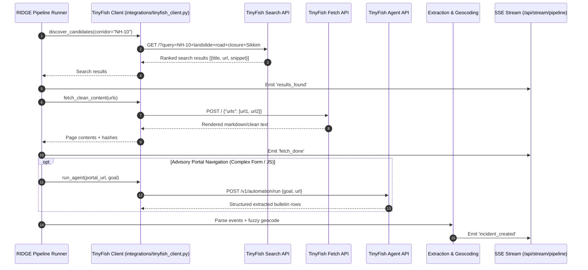

# TinyFish Integration in RIDGE

RIDGE is built from the ground up around TinyFish as the sole web intelligence engine. Traditional static scraping fails in India's North-Eastern Region because road advisories are scattered across regional news outlets, district police Facebook bulletins, local government portals, and emergency relief blogs.



## Where & Why Each TinyFish API Is Used

| TinyFish API | Where in RIDGE | Why It Is Used |
|---|---|---|
| **Search API** | `backend/app/pipeline/discover.py` | Automatically discovers fresh advisories, bulletins, and local news across dynamic keywords (e.g., `NH-10 landslide road blocked`, `Guwahati Shillong NH6 waterlogging`). |
| **Fetch API** | `backend/app/pipeline/fetch.py` | Cleanly renders heavy JavaScript, regional news portals, and government advisory pages without needing fragile CSS selectors or custom scraper maintenance. |
| **Agent API** | `backend/app/integrations/tinyfish_client.py` (under `ENABLE_TINYFISH_AGENT=true`) | Navigates state portal tables and traffic advisory bulletins that require multi-step interaction to read current alerts. |
| **Browser API** | Configured wrapper in `tinyfish_client.py` | Direct remote CDP session capability for anti-bot protected pages. |

## Sample Search Request & Response

### Request
```http
GET https://api.search.tinyfish.ai?query=NH-10+landslide+road+blocked+Sikkim&location=IN&language=en
X-API-Key: $TINYFISH_API_KEY
```

### Response
```json
{
  "results": [
    {
      "title": "Massive landslide halts traffic on NH-10 near 29th Mile",
      "url": "https://sikkimexpress.com/news-details/massive-landslide-nh10-traffic-halted",
      "snippet": "Vehicular movement between Siliguri and Gangtok has been suspended following a major landslide at 29th Mile early Tuesday morning..."
    }
  ]
}
```

## Sample Fetch Request & Response

### Request
```http
POST https://api.fetch.tinyfish.ai
X-API-Key: $TINYFISH_API_KEY
Content-Type: application/json

{
  "urls": ["https://sikkimexpress.com/news-details/massive-landslide-nh10-traffic-halted"]
}
```

### Response
```json
{
  "results": [
    {
      "url": "https://sikkimexpress.com/news-details/massive-landslide-nh10-traffic-halted",
      "status": 200,
      "content": "# Massive landslide halts traffic on NH-10 near 29th Mile\nVehicular movement on National Highway 10 connecting Sikkim with Siliguri was brought to a standstill on Tuesday after a massive landslide at 29th Mile..."
    }
  ]
}
```

## Provenance & Attribution
Every incident generated through RIDGE stores complete provenance:
- Source URL & domain
- Fetch timestamp
- Exact evidence snippet extracted
- Specific TinyFish API endpoint utilized
- Request hash for reproducible auditability
